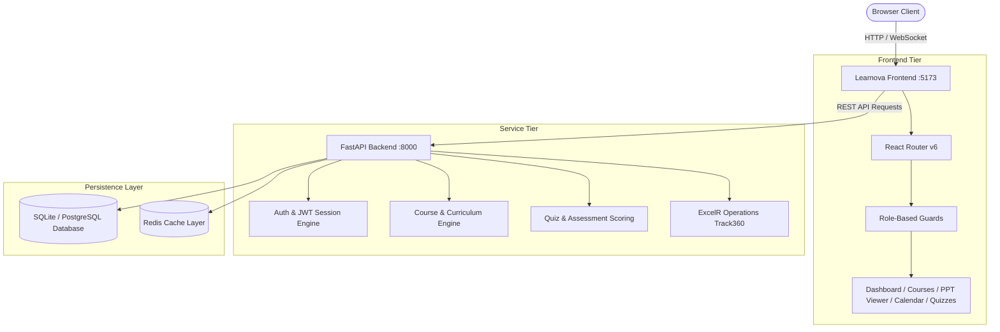

# 🎓 LEARNOVA AI

<div align="center">

```
  _                                            
 | |    ___  __ _ _ __ _ __   _____   ____ _   
 | |   / _ \/ _` | '__| '_ \ / _ \ \ / / _` |  
 | |__|  __/ (_| | |  | | | | (_) \ V / (_| |  
 |_____\___|\__,_|_|  |_| |_|\___/ \_/ \__,_|  
              INTELLIGENT LMS PLATFORM         
```

**"Learn Beyond Borders. Empowering Next-Generation Engineering Leaders."**

[](https://www.python.org/)
[](https://fastapi.tiangolo.com)
[](https://react.dev)
[](https://www.typescriptlang.org)
[](https://tailwindcss.com)
[](https://vitejs.dev)
[](https://vitest.dev)
[](LICENSE)

[Live Features](#-key-features) • [Course Catalog](#-seeded-course-catalog) • [Demo Credentials](#-demo-personas--credentials) • [Quick Start](#-quick-start) • [Architecture](#-architecture) • [API Specs](#-api-documentation)

</div>

---

## 🌟 Executive Summary

**Learnova** is an enterprise-grade, modern Learning Management System (LMS) designed for cutting-edge engineering disciplines. It blends a sophisticated dark glassmorphic design system (`#0B0F19`) with interactive multi-format course delivery:

* 📑 **Interactive Slide Decks (PPT)**: Slide-by-slide in-browser presentation viewer with notes and download actions.
* 🎬 **HD Video Lectures**: Embedded streaming lectures with multi-speed controls and progress checkpoints.
* 📝 **Real-Time Quizzes & Self-Assessments**: Timed multi-question exams, instant feedback, and attempt retrospectives.
* 🛡️ **Role-Based Access Control (RBAC)**: Tailored navigation for Students, Instructors, and Administrators. *ExcelR Operations (Track360)* is exclusively reserved for staff and hidden from student views.
* 📅 **Dynamic Academic Calendar**: Interactive Month, Week, Day, and Upcoming views with course-level filtering.

---

## 🔑 Demo Personas & Credentials

For fast evaluation, development mode includes single-click autofill buttons on the login page:

| Persona | Role | Email | Password | Access Highlights |
|---|---|---|---|---|
| **Student** | `STUDENT` | `student@learnova.ai` | `Student123!` | Enrolled courses, PPT viewer, quizzes, clean focused navigation (Track360 hidden) |
| **Instructor** | `INSTRUCTOR` | `instructor@learnova.ai` | `Instructor123!` | Course builder, quiz authoring, student gradebook, ExcelR Track360 operations |
| **Admin** | `ADMIN` | `admin@learnova.ai` | `Admin123!` | User management, security audit logs, platform analytics, Track360 management |
| **Super Admin** | `SUPER_ADMIN` | `superadmin@learnova.ai` | `SuperAdmin123!` | Global organization settings, full role assignments, database maintenance |

---

## 🚀 Key Features

### 1. 🎨 Original Modern UI & Theme
- Built from the ground up with a dark obsidian/slate canvas (`#0B0F19`), glowing indigo/violet ambient lights, and glassmorphic card containers.
- **Standalone Full-Screen Hero**: Clean "Learn Beyond Borders" landing page with a 3-column capsule gallery of diverse engineering learners.
- **Learnova AI Copilot**: Quick-access AI assistant pill button directly accessible from the navigation bar.

### 2. 📑 Multi-Format Course Learning Engine
- **Presentation Decks (PPT)**: Slide-by-slide interactive presentation viewer with progress counters, slide summaries, and download triggers.
- **Video & Markdown Lessons**: Native video streaming player with automatic completion tracking.
- **Self-Assessments**: Low-stakes knowledge checks throughout modules with detailed explanations.
- **Graded Quizzes**: Multi-choice, single-select, and true/false assessment builder with real-time timers and instant scoring.

### 3. 📅 Interactive Academic Calendar
- **4 Switchable Views**: Month (calendar grid), Week (7-day timeline), Day (daily schedule), and Upcoming (chronological list).
- **Dynamic Course Filtering**: Filter the entire schedule by individual course or view all combined milestones.
- **Color-Coded Badges**: Deadlines (red), Course modules (blue), Live workshops (purple), and Self-assessments (green).

### 4. 🏢 ExcelR Operations (Track360)
- Enterprise operations suite featuring **Learner Management**, **Assignments**, **Projects**, **Certificates**, and **Integration Health**.
- **Student Privacy & Isolation**: Protected by route guards and navigation filters—hidden from learners, active for instructors and administrators.

---

## 📚 Seeded Course Catalog

Learnova comes pre-seeded with 4 comprehensive enterprise curricula:

```
├── 1. Full-Stack Cloud & DevOps Engineering (cloud-devops)
│   ├── Module 1: Container Architecture & Dockerfile Optimization
│   │   ├── Lesson: Linux Namespaces & Cgroups (Text)
│   │   ├── Lesson: High-Performance Dockerfile Build Patterns (Video)
│   │   └── Lesson: Container Optimization & Distroless Images (PPT Deck - 6 Slides)
│   ├── Module 2: Kubernetes Orchestration & Cluster Management
│   │   ├── Lesson: Pod Networking & CNI Plugins (Text)
│   │   └── Lesson: Kubernetes Cluster Deployment & Helm (Video)
│   ├── Quiz: Cloud & Containers Competency Check
│   └── Exam: Kubernetes Ingress & Storage Exam
│
├── 2. Enterprise AI Engineering & Large Language Models (ai-data-science)
│   ├── Module 1: Modern Transformer Mechanics & Attention
│   │   ├── Lesson: Scaled Dot-Product & Multi-Head Attention (Text)
│   │   ├── Lesson: Tokenization, Embeddings & Positional Encodings (Video)
│   │   └── Lesson: Transformer Architecture Visualized (PPT Deck - 6 Slides)
│   ├── Module 2: Retrieval Augmented Generation (RAG) Architecture
│   │   ├── Lesson: Vector Database Embeddings & Chunking (Text)
│   │   └── Lesson: Production RAG Pipelines with LangChain (Video)
│   ├── Quiz: Transformer Attention Mechanics Checkpoint
│   └── Exam: Enterprise RAG & Vector Systems Exam
│
├── 3. Advanced Python & Distributed Data Systems (software-engineering)
│   ├── Module 1: Python Concurrency, GIL & Asyncio Architecture
│   │   ├── Lesson: CPython Memory Management & GIL (Text)
│   │   ├── Lesson: Event Loop Internals & Asyncio Best Practices (Video)
│   │   └── Lesson: High-Performance Python & Concurrency (PPT Deck - 6 Slides)
│   ├── Module 2: Distributed Data Processing with PySpark & Kafka
│   │   ├── Lesson: Apache Spark Execution Plans & RDDs (Text)
│   │   └── Lesson: Streaming Data Pipelines with Kafka & Spark (Video)
│   ├── Quiz: Python Internals & Memory Management Quiz
│   └── Exam: PySpark Cluster Computing Exam
│
└── 4. Enterprise Cybersecurity & Zero Trust Systems (cybersecurity)
    ├── Module 1: Zero Trust Network Architecture & Identity Verification
    │   ├── Lesson: BeyondCorp Principles & Perimeterless Security (Text)
    │   ├── Lesson: mTLS Authentication & SPIFFE/SPIRE (Video)
    │   └── Lesson: Zero Trust Architecture Playbook (PPT Deck - 6 Slides)
    ├── Module 2: Cloud Attack Vectors & Incident Response Operations
    │   ├── Lesson: Cloud Control Plane Exploits & Misconfigurations (Text)
    │   └── Lesson: Threat Hunting & SIEM Alert Triaging (Video)
    ├── Quiz: Zero Trust & mTLS Knowledge Check
    └── Exam: Cloud Security Incident Response Exam
```

---

## 🏗️ Architecture



---

## ⚡ Quick Start

### 1. Prerequisites
- **Python**: `3.11+`
- **Node.js**: `18.x+` (with `npm 9+`)
- **Git**

### 2. Clone the Repository
```bash
git clone https://github.com/reegangladis/Learnova-AI.git
cd Learnova-AI
```

### 3. Setup Backend
```bash
# Create and activate virtual environment
python -m venv .venv

# Windows PowerShell:
.\.venv\Scripts\Activate.ps1
# macOS / Linux:
# source .venv/bin/activate

# Install dependencies
pip install -r backend/requirements.txt

# Run backend server
python -m uvicorn backend.app.main:app --host 127.0.0.1 --port 8000 --reload
```
*Backend API will run at: `http://127.0.0.1:8000` (Swagger UI at `/docs`)*

### 4. Setup Frontend
```bash
cd frontend
npm install
npm run dev -- --host 127.0.0.1 --port 5173
```
*Frontend will run at: `http://127.0.0.1:5173`*

---

## 🧪 Testing & Verification

The project is backed by comprehensive automated test suites:

```bash
# Run Frontend Vitest Suite (11 test files, 69 unit/integration tests)
cd frontend
npm test

# Run Production Frontend Build
npm run build

# Run Backend Pytest Suite
pytest backend/tests/ -v
```

---

## 📁 Repository Structure

```
Learnova-AI/
├── frontend/                   # React 18 + Vite + TypeScript Client
│   ├── src/
│   │   ├── components/         # Reusable UI & Navigation (Sidebar, Navbar)
│   │   ├── pages/              # Landing, Login, Courses, Calendar, PPT Viewer, Dashboards
│   │   ├── routes/             # RBAC Route Guards & Route Configuration
│   │   ├── services/           # Typed Axios API Client
│   │   └── context/            # AuthContext & Session State
│   ├── tests/                  # Vitest Component & Integration Tests (69 Tests)
│   ├── package.json
│   └── vite.config.ts
│
├── backend/                    # FastAPI Main LMS Backend
│   ├── app/
│   │   ├── api/v1/             # Endpoints (Auth, Courses, Quizzes, Track360)
│   │   ├── core/               # RBAC, Security, JWT Tokens, Config
│   │   ├── db/                 # Database Session & Course Seeding
│   │   ├── models/             # SQLAlchemy Declarative Models
│   │   ├── repositories/       # Data Access Layer
│   │   └── services/           # Business Logic Layer
│   ├── tests/                  # Pytest Unit & Integration Tests
│   └── requirements.txt
│
└── README.md                   # Primary Documentation
```

---

## 📄 License

This project is licensed under the [MIT License](LICENSE).
Distributed by **Learnova AI**.
