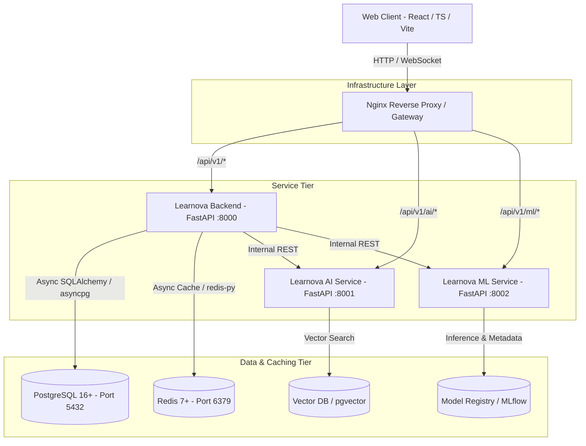

# Learnova AI - System Architecture

## 1. System Vision & Overview

**Learnova AI** is a production-grade, modular Learning Management System (LMS) designed for next-generation personalized education:
> *"Learn Smarter. Learn Personally. Learn with AI."*

The platform unifies enterprise LMS workflows with specialized AI and ML microservices:
1. **Core LMS Backend**: Manages courses, lessons, progress, user personas, roles, and administrative governance.
2. **AI Service**: Dedicated microservice for RAG (Retrieval-Augmented Generation), vector search, LLM orchestration, intelligent tutoring, quiz synthesis, and automated assignment evaluation.
3. **ML Service**: Dedicated microservice for student performance prediction, churn risk scoring, adaptive learning path recommendations, and MLflow-ready model lifecycle management.
4. **Interactive Modern Frontend**: Built with React 18, TypeScript, Tailwind CSS, shadcn/ui design patterns, TanStack Query, and Recharts.

---

## 2. High-Level Architecture Diagram



---

## 3. Core Architectural Principles

- **Clean Architecture & Separation of Concerns**: Clean layers separating API presentation, domain schemas, business services, repositories, and database models.
- **Service Isolation**: Main backend, AI service, and ML service run independently and can be scaled, deployed, or containerized separately.
- **Strict Typing**: Full Python type hints (Python 3.11+) and TypeScript in strict mode for 100% type safety.
- **Async First**: Asynchronous I/O using FastAPI, `asyncpg`, and `redis.asyncio` for high concurrency and low latency.
- **Production Guardrails**: Environment validation that fails fast if critical secrets or production URLs use insecure defaults.
- **Observability**: Structured JSON logging, real-time health checks measuring round-trip database and cache latencies, and OpenTelemetry-ready design.

---

## 4. Subsystem Breakdown

### 4.1 Backend (`backend/`)
- **Framework**: FastAPI with Pydantic v2 validation.
- **ORM & Migrations**: SQLAlchemy 2.0 async engine with Alembic migrations.
- **Caching**: Redis client abstraction with TTL, key invalidation, and session management.
- **Error Handling**: Global exception handler returning standardized envelopes (`{ success: false, error: { code, message } }`).
- **Middleware**: Structured logging middleware capturing duration, method, path, status, and request IDs (with sensitive header sanitization), and configurable CORS middleware.

### 4.2 AI Service (`ai-service/`)
- **Framework**: FastAPI with modular LLM and RAG abstractions.
- **Components**:
  - `llm/`: Provider interfaces (OpenAI, Anthropic, Local) and registry factory.
  - `embeddings/`: Vector embedding generation interfaces.
  - `rag/`: Document ingestion, chunking strategies, and retriever pipelines.
  - `services/`: Intelligent AI Tutor, automated quiz generator, and assignment evaluator abstractions.

### 4.3 ML Service (`ml-service/`)
- **Framework**: FastAPI with Scikit-learn, Pandas, NumPy, and MLflow hooks.
- **Components**:
  - `datasets/`: Dataset loading and validation pipelines.
  - `features/`: Feature engineering and transformation pipelines.
  - `models/`: Model registry and prediction engines.
  - `training/`: Training orchestration and hyperparameter tuning.
  - `evaluation/`: Accuracy, precision, recall, F1, and ROC-AUC evaluation metrics.

### 4.4 Frontend (`frontend/`)
- **Framework**: React 18, Vite, TypeScript.
- **Styling**: Tailwind CSS with CSS custom variables, dark/light theme switching, and accessible shadcn/ui components.
- **State & Data Fetching**: TanStack Query (React Query) with centralized API client.
- **Visualization**: Recharts for performance and diagnostic telemetry.

---

## 5. Security Architecture

1. **Zero Hardcoded Secrets**: All configuration read strictly from `.env` or system environment.
2. **Environment Validation**: In production mode, application startup refuses to proceed if default passwords or localhost endpoints are configured.
3. **Sensitive Data Sanitization**: Logging middleware automatically redacts sensitive query parameters and suppresses authorization headers.
4. **CORS Isolation**: Explicitly allowed origins configured via environment variables.

---

## 6. Directory Structure Overview

```
learnova-ai/
├── frontend/             # React + Vite + TypeScript Frontend
├── backend/              # FastAPI Main Backend + SQLAlchemy + Alembic
├── ai-service/           # FastAPI AI & RAG Microservice
├── ml-service/           # FastAPI ML & Analytics Microservice
├── infrastructure/       # Docker Compose, Nginx, and Deployment Scripts
├── docs/                 # Architecture, Development, and API Specifications
├── docker-compose.yml    # Development Infrastructure Composition
├── .env.example          # Template Environment Configuration
└── README.md             # Primary Project Documentation
```

---

## 7. Multi-Tenant Data Isolation & Database Security Guarantees

### 7.1 PostgreSQL Row-Level Security (RLS) Status
> [!IMPORTANT]
> **PostgreSQL Row-Level Security (RLS) is NOT enabled at the database engine level in this release.**
> 
> All multi-tenant data boundary protection is enforced programmatically at the **Application & Repository Layer** (via SQL queries explicitly scoped by `organization_id`, strict instructor ownership checks, and role-based access controllers).

### 7.2 Application-Level Data Boundaries
1. **Courses & Content**: Courses with an `organization_id` can only be queried, enrolled in, or administered by authenticated users belonging to that organization (or platform `SUPER_ADMIN`).
2. **Quizzes & Assessments**: Quizzes inherit the parent course's organization boundary. Students must be actively enrolled in the course to attempt quizzes; instructors cannot modify quizzes outside their ownership or organization.
3. **AI Knowledge Base**: RAG vector queries and document chunks are strictly filtered by `course_id` and parent course `organization_id`. Students can never retrieve document chunks from courses they are not enrolled in.
4. **Analytics & Metrics**: Tenant administrators (`ADMIN`) are scoped exclusively to their organization's telemetry; cross-organization analytics queries are rejected with HTTP 403 Forbidden.

---

## 8. AI Tutor & RAG System Guarantees & Constraints

1. **Ingestion Idempotency**: Document ingestion computes SHA-256 hashes of normalized lesson text. Re-ingesting unmodified lesson content produces identical chunk counts without data duplication.
2. **Stale Content Cleanup**: Modifying or deleting lesson text immediately purges old vector chunks from the database (`delete_chunks_for_lesson`) to prevent stale or hallucinated retrievals.
3. **Prompt Injection Guardrails**: Course document excerpts provided to the LLM are explicitly labeled as untrusted reference text in the system prompt. Adversarial instructions embedded in curriculum text (e.g., instructions attempting to reveal API keys or test keys) are neutralized.
4. **Honest Uncertainty**: When vector similarity search yields no relevant course chunks (or low semantic similarity below threshold), the AI Tutor explicitly states that the concept is not covered in the current course materials rather than fabricating facts.
5. **Session Isolation**: AI conversations and message histories are strictly private to the creating student (`user_id`). Access attempts with another student's `conversation_id` are rejected with HTTP 403 Forbidden.

---

## 9. Machine Learning Provenance & Modeling Constraints

### 9.1 Dataset Provenance & Label Generation
> [!WARNING]
> **Experimental Model Notice**: The 600 observations utilized in the benchmark dataset (`ml-service/app/training/pipeline.py`) are **100% synthetic, rule-generated random distributions**, NOT empirical historical student interactions.
> 
> The reported high benchmark evaluation accuracy (~95–100%) is an expected mathematical consequence of distinct non-overlapping synthetic boundaries (`np.random.uniform`) for low, moderate, and high risk classes. This model must be treated as **experimental** and must undergo independent validation once real learner behavioral data is collected.

### 9.2 Deserialization Security
Model artifacts are persisted as `.pkl` files in `ml-service/app/models/registry/`. While cryptographic SHA-256 integrity checks against companion JSON metadata are enforced prior to loading, standard `pickle` deserialization retains inherent arbitrary execution risks if registry storage is compromised. Migration to signed formats or `skops` is required for multi-tenant cloud deployments.

---

## 10. Audit Risk Classification & Resolution (Phase 9)

| Priority | Finding / Description | Status | Remediation Applied |
| :--- | :--- | :--- | :--- |
| **P0** | **Backend Container Startup Failure**: In-process imports from `app.embeddings` in `ai_service.py` failed inside standalone backend containers. | **FIXED** | Added self-contained fallback adapters in `backend/app/services/ai_service.py` and `RUN ln -s /app /app/backend` in `backend/Dockerfile`. |
| **P0** | **Multi-Tenant Enrollment Bypass**: Students without an organization could enroll in tenant-private courses due to `and current_user.organization_id` check. | **FIXED** | Enforced strict check: `if course.organization_id is not None and current_user.organization_id != course.organization_id` in `LearningService`. |
| **P1** | **Docker Compose Environment Gaps**: Missing `DATABASE_SYNC_URL` for backend and missing database/redis variables for `ml-service`. | **FIXED** | Added `DATABASE_SYNC_URL`, `ml-service` database/redis environments, and healthchecks in `docker-compose.yml`. |
| **P1** | **CSRF Check Omitted Referer**: State-changing cookie requests without `Origin` could bypass CSRF verification in certain browsers. | **FIXED** | Added `Referer` origin parsing fallback in `SecurityHeadersMiddleware`. |
| **P1** | **Unauthenticated Microservice Ports**: Internal `ml-service` and `ai-service` ports exposed directly on host without service tokens. | **DOCUMENTED** | Documented requirement to bind internal services to internal Docker network only in production. |
| **P2** | **Python Ruff Import Sorting Errors**: 88 `I001` lint warnings across Python services. | **FIXED** | Automatically sorted and formatted all imports via Ruff. |

---

## 11. Production Deployment Blockers & Prerequisites

Before deploying to production (Phase 10), the following operational prerequisites must be resolved:
1. **Production Secrets**: Replace all development secrets in `.env` (`JWT_SECRET_KEY`, database passwords, redis passwords) with high-entropy cryptographic strings.
2. **Database Engine Row-Level Security**: If defense-in-depth database-level isolation is required by enterprise compliance, implement native PostgreSQL RLS policies in an Alembic migration.
3. **Internal Service Authentication**: Implement mTLS or internal shared secret headers (`X-Internal-Service-Key`) between backend, AI service, and ML service.
4. **Empirical ML Telemetry**: Retrain and calibrate the risk prediction model on real anonymized student study logs rather than synthetic distributions.
5. **Database Backups**: Configure automated continuous WAL archiving (pgBackRest or AWS RDS Automated Backups) with point-in-time recovery testing.

