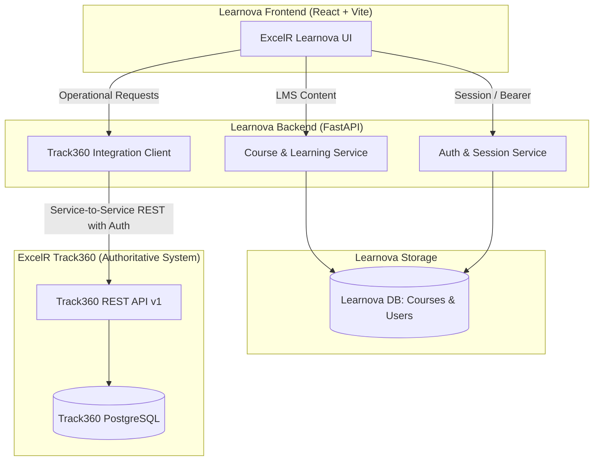
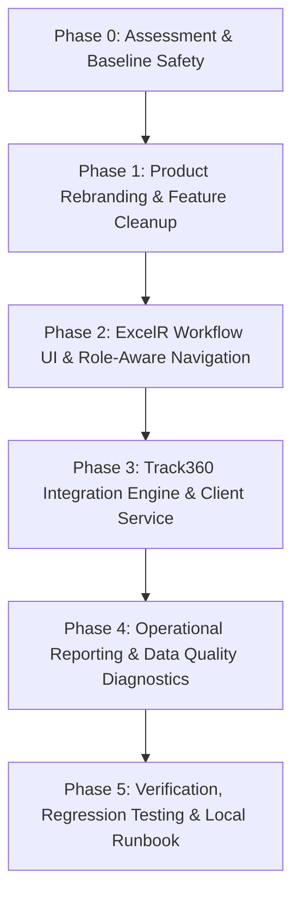

# ExcelR Learnova — System Transformation Assessment & Architectural Strategy

> **Target Platform:** ExcelR Learnova — Learning & Progress Platform  
> **Source Platform:** Learnova-AI LMS & Microservices Architecture  
> **Authoritative Operational Partner:** ExcelR Track360 (Student Lifecycle & Operations Management Platform)  
> **Date:** October 28, 2026  
> **Document Status:** Authoritative Architectural Assessment & Transformation Plan (Phase 0 Deliverable)

---

## Executive Summary

This assessment outlines the systematic transformation of the generic **Learnova-AI** product into **ExcelR Learnova — Learning & Progress Platform**, fully integrated with **ExcelR Track360**. 

Learnova-AI is an existing full-stack Learning Management System built with FastAPI, PostgreSQL/SQLite, SQLAlchemy 2.0, Redis, React 18, Vite, and Tailwind CSS, supplemented by AI/ML microservices (Qdrant, LangChain, SentenceTransformers, Scikit-learn). 

ExcelR Track360 has been located at `C:\Users\ExcelR\OneDrive\Desktop\ExcelR Track360`. It is a modular monolith built on FastAPI, PostgreSQL 15, SQLAlchemy 2.0 Async, Pydantic v2, and React 18 with 37 database tables covering candidate rosters, cohorts, assignment attempt versioning and rubrics, project groups, milestone reviews, 15-day allocation SLAs, internship durations, two-tier certificate approvals, and tamper-evident QR verification.

In accordance with ExcelR core enterprise architecture:
- **Track360** is the single authoritative system of record for operational data: Candidate Golden Profile, Assignment Evaluations (`Not submitted`, `Submitted`, `Redo`, `Done`), Evaluator Notes, Project Allocations and Lifecycle (`Allocated`, `In progress`, `Completed`, `Dropped`), 15-business-day Allocation SLA calculation, and Certificate Issuance/Eligibility.
- **Learnova** is the learner experience and course delivery platform: Course catalog, syllabus modules, video/text lesson player, progress tracking, role-aware staff and learner dashboards, and display of synchronized Track360 progress.
- **No Duplicate Sources of Truth:** Learnova will not maintain competing tables or independent status calculators for assignments, project allocation queues, or certificate issuance.

---

## 1. Existing Learnova-AI Capabilities

Learnova-AI was architected as an AI-powered enterprise LMS. Its current repository consists of:

### 1.1 Backend Architecture (`backend/`)
- **Framework:** FastAPI with Python 3.11, Pydantic v2 schemas, SQLAlchemy 2.0 async ORM, Alembic migrations (versions 001 through 006).
- **Core Security & Authentication:**
  - Secure bcrypt password hashing with configurable salt rounds and password strength validation.
  - Dual JWT token authentication: Access tokens stored in `HttpOnly`, `SameSite=Lax` cookies, and rotating refresh tokens in the database.
  - Multi-session tracking with device metadata, concurrent session revocation, and brute-force account locking (5 failed attempts -> 15-minute lockout).
  - Fine-grained RBAC with System Roles (`SUPER_ADMIN`, `ADMIN`, `INSTRUCTOR`, `STUDENT`) and module-level permissions.
  - Rate limiting middleware with Redis/in-memory fallback, security response headers (`CSP`, `HSTS`, `X-Content-Type-Options`, `X-Frame-Options`), and structured JSON request logging with PII masking.
- **Learning & Course Delivery:**
  - Organization multi-tenancy (`organizations` table).
  - Course catalog, categories, difficulty levels, duration, and status workflow (`DRAFT`, `PUBLISHED`, `ARCHIVED`).
  - Hierarchical curriculum structure: Courses -> Modules -> Lessons (with `TEXT`, `VIDEO`, `QUIZ`, `RESOURCE` content types).
  - Student enrollment management (`enrollments` table: `ACTIVE`, `COMPLETED`, `CANCELLED`, `SUSPENDED`).
  - Granular lesson-level progress tracking (`lesson_progress` table: `NOT_STARTED`, `IN_PROGRESS`, `COMPLETED`), video watch time, and completed percentage calculation.
- **AI & ML Subsystems (Generic / Candidate for Removal/Refactoring):**
  - AI Tutor endpoints (`/api/v1/ai/...`), RAG document chunking, embeddings via Qdrant/SentenceTransformers, and LLM chat sessions.
  - AI quiz generator and synthetic student risk predictions (`/api/v1/ml/...`).
  - Standalone microservices: `ai-service/` (port 8001) and `ml-service/` (port 8002).

### 1.2 Frontend Architecture (`frontend/`)
- **Tech Stack:** React 18.3, TypeScript 5.5, Vite 5.4, Tailwind CSS 3.4, `@tanstack/react-query` v5, `react-router-dom` v6, `react-hook-form` with `zod` validation, Lucide icons, Recharts.
- **Pages & Routes:**
  - Auth: `LoginPage`, `RegisterPage`, `ForgotPasswordPage`, `ResetPasswordPage`, `VerifyEmailPage`, `SecuritySessionsPage`, `SessionExpiredPage`.
  - Learner: `DashboardPage`, `MyLearningPage`, `CoursesPage`, `CourseDetailPage`, `CourseLearningPage` (curriculum drawer + video/text lesson viewer).
  - Staff / Admin: `InstructorCoursesPage`, `CourseEditorPage`, `CourseBuilderPage`, `AdminUsersPage`, `AdminCategoriesPage`, `SystemStatusPage`.
  - Analytics & AI: `StudentAnalyticsDashboard`, `InstructorAnalyticsDashboard`, `AITutorPanel`, `QuizBuilderPage`, `QuizTakingPage`, `QuizResultPage`.
- **Baseline Quality:** 11 test suites passing (69 unit tests), TypeScript compiles with 0 errors, Vite production build completes cleanly.

---

## 2. Existing Track360 Capabilities

Track360 is located at `C:\Users\ExcelR\OneDrive\Desktop\ExcelR Track360`. It is a production-designed Student Lifecycle & Operations Management platform with extensive domain logic:

### 2.1 Backend Architecture & API Structure
- **Framework:** FastAPI, Python 3.11, PostgreSQL 15, SQLAlchemy 2.0 Async, Alembic migrations (Phase 5 through 12).
- **Authentication:** Server-managed sessions via HttpOnly cookie `track360_session` or standard `Authorization: Bearer <session_token>` header. Public verification portal requires zero authentication.
- **Domain Modules:**
  1. **Candidate & Cohort Master (`/api/v1/candidates`, `/api/v1/courses`, `/api/v1/batches`):**
     - Single Golden Profile with external candidate numbers, masked views (`view_masked`), contact info (`view_full`), batch enrollments, and CSV bulk roster validation/ingestion.
  2. **Assignment & Submission Management (`/api/v1/assignments`):**
     - Course assignment specifications, passing scores, rubrics, and cohort allocations.
     - Submissions with attempt versioning (`/submissions/{id}/submit`), evaluator grading with rubric scoring (`/submissions/{id}/review`).
     - Bulk assignment status endpoint (`POST /assignments/submissions/bulk-status`) supporting exact business statuses: `Not submitted`, `Submitted`, `Redo`, `Done`.
     - Strict validation: Evaluator notes are mandatory when status is `Redo` (minimum 5 non-whitespace characters).
     - Authoritative eligibility gating: Gating to project allocation is automatically evaluated upon mandatory assignments marked `Done`.
  3. **Project Allocation & Milestone Progress (`/api/v1/projects`):**
     - Project catalog, milestone deliverable specs, and group collaboration tracking (custom team sizes).
     - Project allocation queue (`GET /projects/queue`) with server-calculated 15-business-day target tracking (excluding weekends) and overdue flags.
     - Group readiness diagnostics (`GET /groups/{id}/readiness`) and group tier progression (`POST /groups/{id}/advance`).
     - Project drop endpoint (`POST /groups/{group_id}/allocations/{allocation_id}/drop`) with mandatory coordinator drop reasons and immutable historical preservation.
  4. **Internships (`/api/v1/internships`):**
     - Tracking corporate calendar internship records, milestone sign-offs, and accredited durations.
  5. **Certificates (`/api/v1/certificates`):**
     - Prerequisite eligibility diagnostics (`GET /certificates/eligibility/{candidate_id}`).
     - Two-stage approval workflow: Stage 1 reviewer verification (`POST /{id}/review`) -> Stage 2 approver sign-off (`POST /{id}/approve`).
     - Public verification endpoint (`GET /certificates/public-verify/{identifier}`) with dynamic QR tokens.
     - Revocation workflow (`POST /{id}/revoke`) with auditable categories.
  6. **Audit & Notifications (`/api/v1/audit`, `/api/v1/notifications`):**
     - Immutable event logging with actor IDs, IP addresses, user agents, and entity diffs.

---

## 3. Features to Retain

| Feature Area | Component / Service | Reason for Retention |
| :--- | :--- | :--- |
| **Authentication & RBAC** | JWT Auth, Cookies, Password Hashing, Session Management, RBAC middleware | Robust enterprise-grade authentication; adaptable to ExcelR roles. |
| **User & Staff Profiles** | `User`, `Role`, `UserRole`, `Session` models and endpoints | Necessary for managing ExcelR instructors, coordinators, evaluators, and learners. |
| **Course & Curriculum** | `Course`, `CourseModule`, `Lesson`, `CourseCategory` models & views | Core LMS functionality for course delivery, video lessons, and syllabus browsing. |
| **Enrollment & Learning** | `Enrollment`, `LessonProgress` models, `CourseLearningPage`, `MyLearningPage` | Core learner experience for accessing enrolled modules and completing lessons. |
| **UI Component System** | Buttons, Cards, Dialogs, Tables, Badges, Inputs, Layouts (Sidebar, Navbar) | High-quality, responsive component primitives built with Tailwind CSS. |
| **Security Controls** | Security headers, CORS configuration, Structured JSON logging, Rate limiting | Enterprise security posture and compliance. |

---

## 4. Features to Remove or Disable

| Feature | Action | Justification |
| :--- | :--- | :--- |
| **AI Tutor Chat & LangChain** | Remove from UI & disable routes | Unrelated generic AI product feature. ExcelR uses direct human mentoring and instruction. |
| **RAG Ingestion & Vector DB** | Remove dependencies on Qdrant/Embeddings | Heavy, unnecessary operational footprint. Not part of ExcelR progress management. |
| **AI Quiz Generation** | Remove automatic AI generator | ExcelR uses human-evaluated practical assignments and Track360 rubrics. |
| **Synthetic ML Churn / Analytics** | Remove from UI and disable service | Synthetic churn predictions do not reflect real learner progress and risk misleading staff. |
| **AI / ML Microservices Containers** | Remove `ai-service` and `ml-service` from Docker Compose | Streamlines resource usage; prevents unnecessary failure points during deployment. |
| **Removed UI Routes** | De-route AI tutor, ML recommendations, and standalone quiz taking | Clean, professional ExcelR navigation without dead links or nonfunctional widgets. |

---

## 5. Features to Build or Adapt for ExcelR

1. **ExcelR Brand Transformation:**
   - Full visual redesign to **ExcelR Learnova — Learning & Progress Platform**.
   - Clean enterprise color palette (Navy Blue `#0A2540`, ExcelR Blue `#1E40AF` / `#2563EB`, Crisp Slate `#F8FAFC`).
   - Professional header, navigation, typography, login screen, and empty/error states.
2. **Dedicated Track360 Integration Layer (`Track360Service` / `Track360Client`):**
   - Typed HTTP client with retry policies, connection timeouts, health probes, and error handling.
   - Integration status indicator for administrators (`CONNECTED`, `UNAVAILABLE`, `AUTH_ERROR`, `NOT_CONFIGURED`).
   - Graceful fallback: If Track360 is temporarily offline, Learnova functions safely in learning mode and displays clear integration warnings rather than fabricating data.
3. **ExcelR Learner Management:**
   - Consolidated Learner Directory and 360-Degree Learner Profile.
   - Cross-system mapping: Learnova learner identity mapped to Track360 Candidate Number.
   - Overview of enrolled courses, assignment submission statuses, project allocation history, and certificate eligibility.
4. **ExcelR Assignment Tracking View:**
   - Spreadsheet-style assignment grid for authorized evaluators and coordinators.
   - Filterable by cohort/batch, course, assignment code, and status (`Not submitted`, `Submitted`, `Redo`, `Done`).
   - Evaluator note modal with mandatory length validation for `Redo` status.
   - Support for bulk status updates via Track360's `POST /assignments/submissions/bulk-status`.
5. **Project Allocation & Lifecycle Dashboard:**
   - Real-time project queue view synchronized with Track360.
   - SLA tracking: 15-business-day target progress bar and overdue warnings.
   - Project group views, milestone completion, and dropped-project history with mandatory coordinator reason display.
6. **Certificate Status & Verification:**
   - Learner-facing credential tab showing Course Completion and Internship Certificate status.
   - Duration display: 1 project = 3 months, 2 projects = 6 months, 3 projects = 9 months.
   - Link to public cryptographic verification portal and PDF download where issued by Track360.
7. **Operational Reporting:**
   - Executive and coordinator reports: Batch assignment completion rate, project SLA adherence, overdue allocations, and certificate pipeline.

---

## 6. Integration Boundaries & Data Flow

### Authoritative Responsibility Matrix
| Domain / Entity | Authoritative System | Learnova Responsibility |
| :--- | :--- | :--- |
| **Learner Master & Candidate Profile** | **Track360** | Mirrors golden profile; maps Learnova user to `candidate_number`. |
| **Course Catalog & Lesson Content** | **Learnova** | Authoritative for syllabus, video streaming, and lesson completion. |
| **Assignment Evaluation & Status** | **Track360** | Displays authoritative status (`Not submitted`, `Submitted`, `Redo`, `Done`); submits reviews to Track360. |
| **Evaluator Notes for Redo** | **Track360** | Enforces note validation before sending update to Track360; displays notes to authorized staff and students. |
| **Project Allocation Queue & SLA** | **Track360** | Displays queue, elapsed business days, and SLA overdue badges calculated by Track360. |
| **Project Groups & Dropped Status** | **Track360** | Displays team members, milestone status, and drop reasons recorded by coordinators. |
| **Certificate Eligibility & Issuance** | **Track360** | Displays diagnostic eligibility, two-stage approval status, dynamic QR link, and PDF download. |

---

## 7. Existing Database and API Dependencies

### Learnova Backend Dependencies
- **Database Engine:** SQLite (local development) / PostgreSQL (production).
- **Core Tables:** `users`, `roles`, `permissions`, `user_roles`, `role_permissions`, `sessions`, `refresh_tokens`, `courses`, `course_modules`, `lessons`, `course_categories`, `enrollments`, `lesson_progress`, `audit_logs`.
- **Tables to Retire / Deprecate:** `ai_conversations`, `ai_messages`, `document_chunks`, `ingestion_jobs`, `quiz_questions`, `question_options`, `quizzes`, `quiz_attempts`, `quiz_answers`.

### Track360 API Integration Contract
- **Base URL:** Configured via `TRACK360_BASE_URL` (default: `http://localhost:8000` or dedicated port).
- **Authentication:** Service credentials via `TRACK360_SERVICE_EMAIL` and `TRACK360_SERVICE_PASSWORD`, obtaining a session Bearer token automatically, or direct service API key.
- **Endpoints Utilized:**
  - `GET /api/v1/system/health`: Integration connectivity probe.
  - `GET /api/v1/candidates`: Learner search and profile retrieval.
  - `GET /api/v1/candidates/{id}`: Full candidate progress summary.
  - `GET /api/v1/assignments/submissions`: Assignment overview and filterable submissions.
  - `POST /api/v1/assignments/submissions/bulk-status`: Evaluator bulk status transitions with mandatory Redo note.
  - `GET /api/v1/projects/queue`: Project allocation queue and SLA tracking.
  - `POST /api/v1/projects/groups/{group_id}/allocations/{allocation_id}/drop`: Record dropped project with coordinator reason.
  - `GET /api/v1/certificates`: Certificate registry and student certificates.
  - `GET /api/v1/certificates/eligibility/{candidate_id}`: Eligibility diagnostic.
  - `GET /api/v1/certificates/public-verify/{identifier}`: Verification portal link.

---

## 8. Risks, Missing Information, and Unresolved Decisions

In accordance with ExcelR governance, the following decisions are preserved as explicit configuration options and documented as unresolved:

1. **Learner Master Key Reconciliation:**
   - *Status:* Learnova uses UUIDs for `User.id`; Track360 uses UUIDs for `Candidate.id` alongside human-readable `candidate_number` (e.g., `EXCELR-2026-0001`) and email.
   - *Strategy:* Primary matching by verified email address with fallback to candidate number mapping.
2. **Project Team Sizing:**
   - *Status:* BRD states group sizing varies by cohort and track policy; no single fixed size (e.g., 4) is mandated.
   - *Strategy:* Group size is treated as a dynamic parameter configured in Track360.
3. **Internship Certificate Duration Interpretation:**
   - *Status:* BRD defines 1 project = 3 months, 2 projects = 6 months, 3 projects = 9 months. Whether durations run concurrently or cumulatively for overlapping project calendars is under business review.
   - *Strategy:* Learnova will display the authoritative accredited duration calculated and approved by Track360 without calculating independent durations.
4. **NASSCOM Clearance Integration:**
   - *Status:* Official NASSCOM test score integration is currently recorded in Track360 as a coordinator manual milestone.
   - *Strategy:* Display clearance status directly from Track360 eligibility diagnostics.
5. **Direct Student Submissions:**
   - *Status:* ExcelR standard operational flow utilizes email and external submission repositories in current cohorts.
   - *Strategy:* Learnova displays submission instructions, statuses, and links; file uploads do not bypass the established Track360 submission workflow.

---

## 9. Phased Implementation Plan

### Detailed Phase Milestones:
- **Phase 0 (Complete):** Repository inspection of Learnova-AI and Track360, test baseline establishment, architecture assessment documentation.
- **Phase 1:** Rebrand to ExcelR Learnova. Remove AI/ML navigation links and dead endpoints. Clean configuration and Docker Compose files. Ensure TypeScript and backend build cleanly.
- **Phase 2:** Build ExcelR role-aware navigation and pages: Learners, Assignments Grid, Project Queue & Allocations, Certificates, System Integration Health.
- **Phase 3:** Implement `Track360Client` and backend proxy endpoints with connection pooling, retries, timeouts, and mocked integration test coverage.
- **Phase 4:** Build operational dashboards and reporting filters (SLA compliance, assignment redo counts, cohort completion).
- **Phase 5:** End-to-end test execution, database verification, and comprehensive verification reporting.

